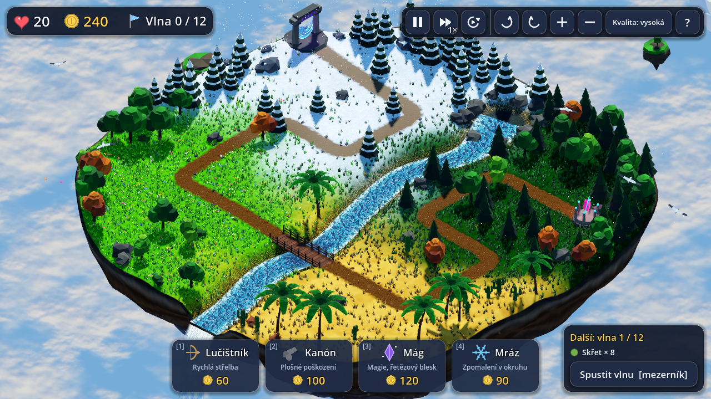
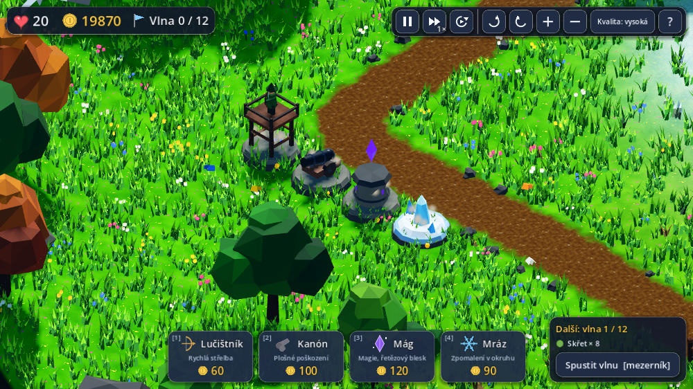
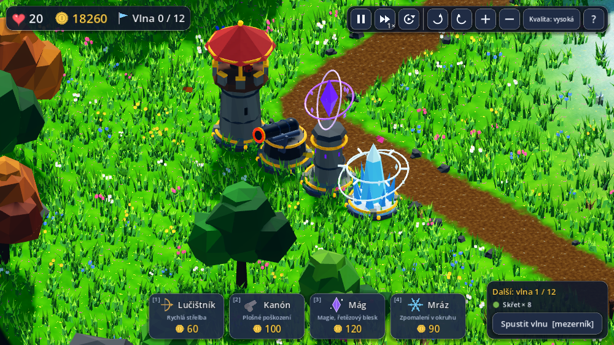
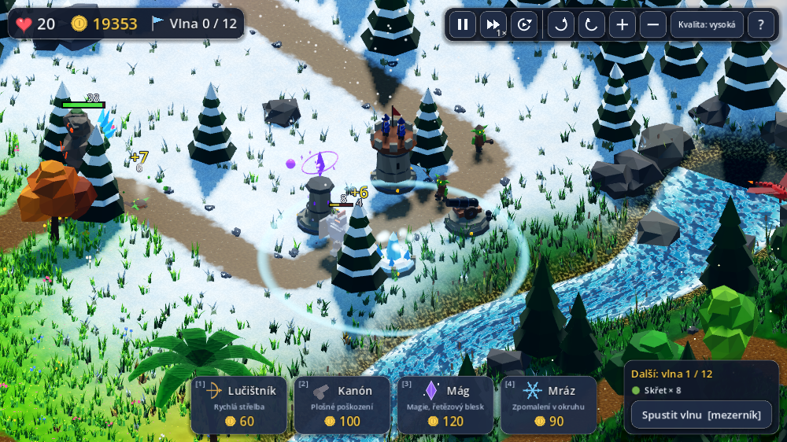
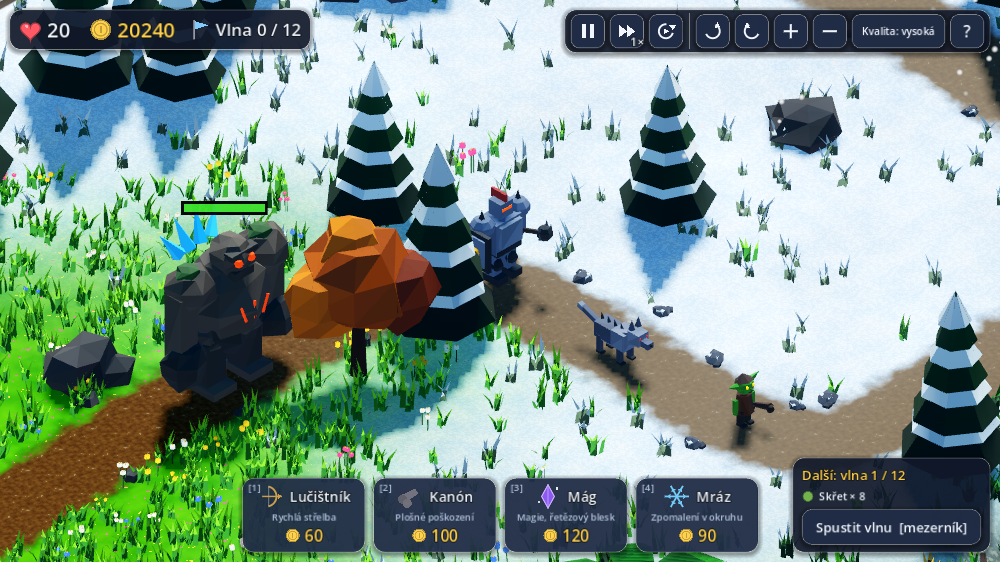
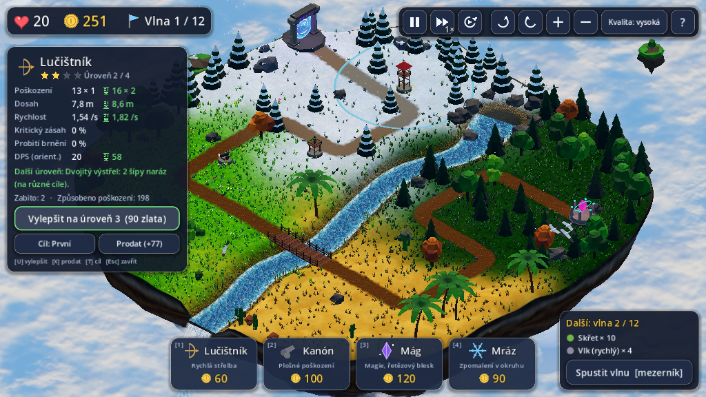
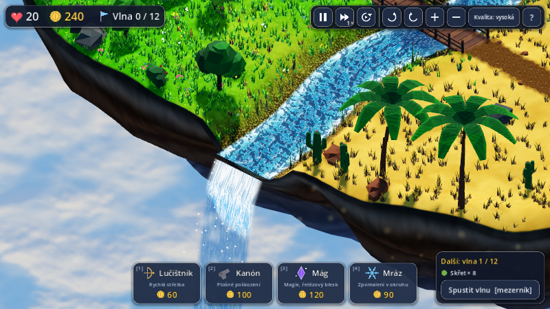

# Ostrov v oblacích – 3D izometrická tower defense

Hra pro webový prohlížeč, postavená na **Godotu 4.7.2** (aktuální stabilní verze, vykreslování *Compatibility* = WebGL 2).
Veškerá grafika (terén, stromy, voda, věže, nepřátelé, efekty, rozhraní, ikony) i **zvuk a hudba** jsou vytvořené **přímo v kódu** – ve hře nejsou žádné obrázky, modely ani zvukové soubory.



| | |
|---|---|
|  **Věže, úroveň 1** |  **Stejné věže po vylepšení na úroveň 4** |
|  **Boj: mrazový pulz, výbuchy, čísla poškození** |  **Skřet, vlk, obrněnec a kamenný obr** |
|  **Panel věže s náhledem vylepšení** |  **Řeka padá z ostrova jako vodopád do oblaků** |

## Jak hru spustit

Hra je už sestavená ve složce `docs/`. Prohlížeč ji ale nespustí dvojklikem na `index.html` (zakazuje to načítání souborů z disku), potřebuje malý místní webový server. Ten spustí jedním kliknutím:

| Systém | Co udělat |
|---|---|
| **Windows** | dvojklik na `spustit.bat` (jednorázově nainstaluj zdarma [Python](https://www.python.org/downloads/) a při instalaci zaškrtni *Add python.exe to PATH*) |
| **macOS** | dvojklik na `spustit.command` (Python 3 bývá k dispozici; jinak ho nainstaluj z python.org) |
| **Linux** | `./spustit.sh` |

Otevře se prohlížeč s hrou (adresa `http://localhost:8765/index.html`). Ukončíš ji zavřením okna terminálu.

**Záložní verze pro starší Godot.** Kdyby hra v tvém prohlížeči nešla nebo sekala, zkus build z předchozího Godotu **4.6.3** (stejná hra, stejný kód): dvojklik na `spustit_godot-4.6.bat` (Windows) / `spustit_godot-4.6.command` (macOS) / `./spustit_godot-4.6.sh` (Linux), případně `python3 spustit.py docs-4.6`. Ověřeno: pod 4.6.3 projekt projde importem i exportem, celá simulace dává stejné výsledky a v prohlížeči bot dohrál všech 12 vln bez chyb v konzoli. Zvukový test (33 kontrol, viz níže) prošel i na tomto buildu.
Funguje v aktuálním Chrome / Edge / Firefox. První načtení stahuje ~40 MB (engine), pak už je to rychlé.

## Ovládání

| Akce | Ovládání |
|---|---|
| Postavit věž | karta dole (nebo klávesy **1–4**) → klik na zelené pole vedle cesty |
| Zrušit stavbu / výběr | **Esc**, pravé tlačítko myši (bez tažení) |
| Vybrat věž | klik na ni → panel vlevo (statistiky, náhled vylepšení, prodej, cílení) |
| Vylepšit / prodat / cíl | tlačítka v panelu nebo **U** / **X** / **T** |
| Spustit vlnu | tlačítko vpravo dole nebo **mezerník** (tlačítko „auto“ nahoře spouští vlny samo) |
| Otáčení kamery | **pravé tlačítko myši + tažení**, **Q / E**, tlačítka nahoře |
| Zoom | **kolečko myši**, **+ / −**, tlačítka nahoře |
| Posun kamery | **W A S D** / šipky, nebo prostřední tlačítko myši + tažení |
| Rychlost 1× / 2× / 3× | tlačítko nahoře nebo **F** |
| Pauza | **P** (nebo Esc, když není nic vybráno) |
| Nápověda | **?** nahoře (nebo **H**) |
| Zvuk a hudba | tlačítka **reproduktor** (efekty a ambient) a **nota** (hudba) nahoře; klávesa **M** vypne/zapne vše. Volba se pamatuje |
| Kvalita | tlačítko *Kvalita* (vypne stíny a vyhlazování; na mobilech/slabých strojích se zapne samo) |

## Pravidla

Z **portálu** na jednom konci ostrova vycházejí vlny nepřátel a jdou po cestě (přes sníh, louku, most přes řeku, poušť a les) k **Srdci ostrova**. Když nepřítel dojde na konec, ztratíš životy (boss 5). Za každého zabitého dostaneš zlato, za zvládnutou vlnu bonus. Máš 20 životů a 240 zlata, vln je **12**.

### Věže (každá má 4 úrovně, vzhled se s úrovní mění; počet zlatých drahokamů na podstavci = úroveň)

| Věž | Cena | Mechanika | Co přinášejí vylepšení |
|---|---|---|---|
| **Lučištník** | 60 | rychlé šípy, střílí i po vzduchu, slabý proti brnění | L2 víc dosahu/poškození/rychlosti · L3 **dva šípy naráz** (na různé cíle) · L4 **25 % kritický zásah ×2** a probití 50 % brnění |
| **Kanón** | 100 | pomalá koule po balistické křivce s **výbuchem**, jen pozemní cíle | L2 větší výbuch · L3 **zápalné koule** (hoření) · L4 obří výbuch + **omráčení** |
| **Mág** | 120 | naváděná magická koule, **ignoruje brnění** | L2 síla · L3 **řetězový blesk** na další 2 cíle · L4 blesk na 4 cíle |
| **Mráz** | 90 | kruhový pulz, **zpomalí všechny** v okruhu (i vzdušné) | L2–L3 větší okruh a zpomalení (až 55 %) · L4 zpomalení 65 % a **každý 3. pulz zmrazí** |

Vylepšení stojí 50–240 zlata, prodej vrací 70 % vložených peněz. Věž má režim cílení *První / Poslední / Nejsilnější / Nejbližší*.

### Nepřátelé

| Nepřítel | Vlastnost |
|---|---|
| **Skřet** | základní |
| **Vlk** (rychlý) | 1,9× rychlejší, málo zdraví |
| **Obrněnec** | pomalý, hodně zdraví, **brnění** (snižuje poškození šípů a děl; magie ho ignoruje) |
| **Dráček** (létající) | letí přímo od portálu k Srdci nad stromy, kanón ho nezasáhne |
| **Kamenný obr** (boss) | obří, hodně zdraví a brnění, odolný proti zpomalení; vlny 5, 10 a 12 |

Zdraví nepřátel s vlnami roste (vlna 12 má ×5,4). Přehled další vlny je vpravo dole.

## Svět a technika

- **Létající ostrov** s biomy (sníh, les, poušť, louka – plynule přecházejí), řekou, která vyvěrá z jezírka, protéká pod dřevěným mostem a na okraji ostrova **padá jako vodopád** do oblaků. Spodek ostrova je skalní krápník.
- **Živý svět:** pohyblivé mraky v několika vrstvách, vítr hýbe stromy a trávou (ve vertex shaderu), tekoucí a pěnící voda, padající sníh, pylové jiskřičky v lese, prach v poušti, ptáci, motýli, plovoucí skály, mlha a sprška vodopádu, stíny od slunce.
- **Izometrická kamera:** ortogonální projekce, přesný izometrický sklon 35,264°, otáčení, zoom i posun.
- **Fyzika projektilů:** v každém kroku se projektilu přepočítá rychlost tak, aby letěl po balistické křivce přesně do *předpovězeného* místa cíle v čase dopadu. Cíl jde po známé trase, takže projektil vždy dorazí a zasáhne (i když se cíl zpomalí – křivka se plynule opraví). Dělová koule dopadá s výbuchem, magická koule se vlní a přeskakuje blesky.
- **Pohyb nepřátel** je dán uraženou vzdáleností po vyhlazené trase (zatáčky jsou zaoblené), takže se nemohou zaseknout ani projít skrz překážky; stromy a skály jsou jen mimo trasu a v zablokovaných polích.

### Zvuk a hudba

Žádné zvukové soubory – všechno se **vysyntetizuje v kódu** (`scripts/audio/synth.gd`) při startu hry:

- **30 efektů**: výstřel šípu, rána kanónu a výbuch, kouzlo mága a blesk, mrazový pulz, zásahy, smrt každého typu nepřítele (boss má vlastní), zvonění mince, stavba / vylepšení / prodej, roh na začátku vlny, ztráta života, fanfára výhry a znělka prohry, kroky obra, kliknutí v menu. Efekty jsou **prostorové** (stereo podle toho, kde na ostrově se stanou, a tišší, když jsou daleko), mají drobnou náhodnou změnu výšky a omezení počtu, aby se při velké bitvě nesmísily.
- **Hudba** (d moll): klidná smyčka (88 BPM, pad + brnkání + zvonky) a bojová (124 BPM, basa, bicí, žestě). Při vlně se klidná **plynule prolne** do bojové a po ní zase zpět. Pauza a konec hry hudbu ztlumí.
- **Ambient**: vítr, šumění vody a občas ptáci na různých místech ostrova.
- Prohlížeče zvuk bez kliknutí nepustí, proto se spouští až **po kliknutí na „Začít hru“**. Hudba se dopočítává na pozadí po malých dávkách (hra přitom neseká) a začne hrát zhruba 10–30 s po načtení, na pomalém stroji později; do té doby hraje ambient a efekty.

### Struktura projektu

```
project.godot, export_presets.cfg   nastavení Godotu a exportu pro web
scripts/core/       cfg.gd (všechna čísla: věže, nepřátelé, vlny), mesh_kit.gd (stavba modelů z primitiv), gfx.gd
scripts/world/      terén, trasa, řeka, mřížka polí, generování sítí ostrova
scripts/game/       hra (vlny, zlato, životy), věž, nepřítel, projektil, efekty, kamera, překryvy
scripts/theme/      rozhraní motivu + motiv „Ostrov v oblacích“ (svět, modely věží a nepřátel, ambient)
scripts/ui/         rozhraní (česky), ikony kreslené v kódu
scripts/audio/      syntezátor zvuků a hudby (synth.gd), správce zvuku (audio_manager.gd)
scripts/tools/      testovací nástroje (headless simulátor, API pro testy v prohlížeči, export zvuků do WAV)
shaders/            terén, voda, vodopád, listí s větrem, mraky, portál, efekty
docs/               hotová webová verze (Godot 4.7.2, sem míří export)
docs-4.6/           záložní webová verze z Godotu 4.6.3
tests/              skripty pro automatické testy (Node + Playwright)
```

### Jak přidat další téma (sci-fi, fantasy…)

Pravidla a čísla (`cfg.gd`) jsou oddělená od vzhledu. Nový motiv = nová třída, která dědí z `GameTheme` (`scripts/theme/game_theme.gd`) a přepíše čtyři věci: `build_world` (svět), `make_tower_visual`, `make_enemy_visual`, `make_projectile_visual`. Vzor je `scripts/theme/sky_island/theme_sky_island.gd`; motiv se vybírá v `scripts/main.gd` (řádek s `ThemeSkyIsland.new()`).

### Jak hru znovu sestavit

Potřebuješ Godot **4.7.2** a k němu exportní šablony pro web. Pak:

```bash
tools/build_web.sh /cesta/k/godot      # vytvoří docs/index.html + engine + data
```

## Testy a co bylo ověřeno

Všechno níže běželo na této verzi (Godot 4.7.2.stable, Chromium s programovým vykreslováním WebGL).

| Test | Spuštění | Výsledek |
|---|---|---|
| Headless simulace (pravidla, vylepšení, fyzika, 4 strategie bota na celých 12 vlnách) | `godot --headless --path . -- --simtest --skipintro` | průběh bez chyb, viz níže |
| Odehrání v prohlížeči skutečnou myší a klávesnicí: úvodní okno, stavba 2 lučištníků a kanónu, vylepšení kliknutím na tlačítko, 3 vlny | `node tests/e2e_play.js --low --waves=3` | všechny 3 vlny dokončeny (celkem 37 zabitých, ve vlně 3 proklouzli 4 dráčci – kanón po vzduchu nestřílí), 0 chyb v konzoli |
| Kontrolovaný pokus „jedna věž, stejní nepřátelé, mezi koly vylepšení kliknutím“ pro všechny 4 typy | `node tests/ab_upgrade.js --type=archer` (cannon, mage, frost) | síla roste s každou úrovní, tabulka níže |
| Ovládání a obrazovky (kamera, nepovolená stavba, prodej, cílení, pauza, rychlost, prohra + restart, výhra) | `node tests/ui_flow.js` | 17 / 17 kontrol, 0 chyb v konzoli |
| Celá hra botem uvnitř exportované webové verze | `node tests/browser_bot.js` | 12 vln dohráno, 0 chyb v konzoli |
| Snímky světa / věží / nepřátel / boje | `tests/tour.js`, `gallery.js`, `combat.js` | kontrola vzhledu |
| Zvuk v prohlížeči (měří se skutečný výstup Web Audio, viz níže) | `node tests/audio_browser.js --low` | 33 / 33 kontrol, 0 chyb v konzoli |
| Rozbor všech zvuků (délka, hlasitost, přebuzení, tónina, tempo hudby) | `godot --headless -s scripts/tools/audio_dump.gd -- složka` a pak `python3 tests/audio_analyze.py složka` | všech 30 efektů + ambient + obě písně bez nalezených problémů |

**Zvuk – co přesně se měřilo** (poslech to nenahradí, viz „Co ověřeno nebylo“). Test `audio_browser.js` zachytí skutečný výstup Web Audio v prohlížeči a ověří:

- před prvním kliknutím je výstup tichý, po „Začít hru“ hraje klidná hudba, vítr a voda (RMS ≈ −22 dBFS), `AudioContext` běží,
- tlačítko noty hudbu vypne (hlasitost výstupu klesne ze 0,067 na 0,026, zůstane jen ambient), tlačítko reproduktoru vypne zbytek (0,00003), klávesa **M** vypíná a zapíná vše,
- stavba, vylepšení, výstřely, zásahy, zabití, mince, roh vlny, ztráta života, prohra a výhra přehrají svůj efekt (počítá se, kolikrát který zazněl),
- v boji se hudba plynule prolne z klidné do bojové (−14,6 dB / −9,9 dB) a po vlně zpět,
- **prostorové efekty:** výstřel vlevo od kamery má v levém kanálu 4× víc energie než v pravém, vpravo naopak, přímo před kamerou je stejně v obou,
- **přebuzení:** skutečná největší špička ze všech vzorků za celé hraní (vlna, boj, prohra, výhra) byla 0,70 z 1,0.

Rozbor vygenerovaných souborů (`audio_analyze.py`): žádné NaN, žádné ořezané vzorky, žádná stejnosměrná složka, žádné cvaknutí na začátku/konci efektů, švy smyček bez skoku; tempo písní odhadnuté z nahrávky vyšlo **88 a 125 BPM** (návrh 88 a 124), **94 % a 87 % energie leží v tónině d moll**, bojová hudba je jasnější než klidná (těžiště 1341 vs. 683 Hz). Při tvorbě testu se takto našly a opravily dvě chyby: filtr šumu byl nad 5 kHz nestabilní (fanfára výhry byla o 10 dB tišší, než měla) a vlastní zvukové sběrnice Godotu se na webu zacyklily, takže byl výstup ticho, i když zdroje hrály.

**Změřená síla vylepšení – v prohlížeči, vylepšení skutečným klikem** (jedna věž, pokaždé stejná skupina: 10 skřetů, 3 obrněnci, 6 vlků, 3 dráčci se zvýšeným zdravím; způsobené poškození / zabití / uniklých z 22):

| Věž | Úroveň 1 | Úroveň 2 | Úroveň 3 | Úroveň 4 |
|---|---|---|---|---|
| Lučištník | 387 / 0 / 22 | 690 / 0 / 22 | 2078 / 2 / 20 | 4465 / 13 / 9 |
| Kanón | 616 / 0 / 22 | 1191 / 1 / 21 | 2468 / 3 / 19 | 4833 / 15 / 7 |
| Mág | 700 / 0 / 22 | 1185 / 1 / 21 | 3319 / 6 / 16 | 5780 / 21 / 1 |
| Mráz | 505 / 0 / 22 | 1216 / 0 / 22 | 2808 / 0 / 22 | 5880 / 22 / 0 |

**Totéž v headless simulaci** (jiný, ještě těžší scénář, 24 nepřátel):

| Věž | Úroveň 1 | Úroveň 2 | Úroveň 3 | Úroveň 4 |
|---|---|---|---|---|
| Lučištník – způsobené poškození / zabití | 426 / 0 | 763 / 1 | 2236 / 4 | 4767 / 14 |
| Kanón | 740 / 1 | 1384 / 2 | 2944 / 6 | 5670 / 19 |
| Mág | 1020 / 0 | 1630 / 2 | 3905 / 5 | 6710 / 22 |
| Mráz | 535 / 0 | 1336 / 0 | 3120 / 0 | 6810 / 24 |

**Fyzika a animace** (všech 12 vln, všechny strategie): žádný skok polohy nepřítele mezi kroky větší než jeho rychlost (vnější strana zatáčky ≤ +30 %), svislý pohyb po zemi nejvýš 1,8 cm za krok, nepřítel nikdy blíž než 1,45 m ke stromu či skále, žádný nepřítel neuvízl (nejdelší život 132 s = boss na celé trase). Projektily: ~2400 zásahů a ~4 % „vyšumělých“ (cíl zemřel jiným projektilem dřív, než střela dorazila).

**Vyvážení** (bot s dokonalým umístěním věží): strategie „vylepšuj málo věží“ vyhraje se 15 životy, strategie „hodně slabých věží bez vylepšování“ padne kolem 7. vlny, strategie s mnoha věžemi a slabým vylepšením nezvládne bossy v poslední vlně. První tři vlny zvládnou všichni bez ztráty života (lidský hráč ve vlně 3 narazí na dráčky: kanón na ně nestačí).

### Co ověřeno nebylo

- **Plynulost (FPS) na skutečné grafické kartě.** Tady běží WebGL jen programově (~1–2 snímky/s), takže rychlost vykreslování nejde posoudit. Změřeno: ~207 volání vykreslení, ~800 objektů, ~0,5 mil. trojúhelníků na snímek včetně stínů. Kdyby hra na slabším stroji sekala, přepni tlačítkem *Kvalita* na nízkou.
- Safari, mobilní prohlížeče a dotykové ovládání (kód pro dva prsty a posun je, ale netestováno).
- **Jak zvuk skutečně zní.** Poslouchat neumím, takže kvalitu (jestli je hudba příjemná, jestli jsou efekty vyvážené a nepřehlušují se) musíš posoudit ty. Ověřil jsem jen to, co se dá změřit: že zvuk hraje, kdy má, že tlačítka ho vypnou, že se hudba přepíná podle boje a že výstup nepřebuzuje. Kdyby ti nějaký zvuk nevyhovoval, jsou v `scripts/audio/synth.gd` (receptury) a `audio_manager.gd` (hlasitosti `BASE_DB`, `CALM_DB`…) snadno upravitelné.
- **Smyčky ve webové verzi.** Godot je na webu přehrává tak, že po dohrání zdroj spustí znovu. Na přechodu proto může být krátká mezera, jejíž délka závisí na plynulosti hry (zhruba jeden snímek). V testu na pomalém stroji s ~1–2 snímky/s byla mezera stovky milisekund, na normálním počítači by měla být řádově desítky milisekund. Aby se to dělo zřídka, jsou hudební smyčky dlouhé 31 s a 44 s a ambient 24 s. Na skutečném stroji jsem to neměřil.
- Binárku Godotu 4.7.2 (a web šablony) jsem získal ze zrcadla komunitního Docker image `barichello/godot-ci`, protože oficiální stránky byly v prostředí zablokované. Oficiální kontrolní součet jsem proto neověřil; program hlásí `4.7.2.stable.official`. Výsledný web (`docs/`) ti ale nic dalšího nestahuje – obsahuje jen engine a hru.
