# Ostrov v oblacích – 3D izometrická tower defense

Hra pro webový prohlížeč, postavená na **Godotu 4.7.2** (aktuální stabilní verze, vykreslování *Compatibility* = WebGL 2).
Veškerá grafika (terén, stromy, voda, věže, nepřátelé, efekty, rozhraní, ikony) i **zvuk a hudba** jsou vytvořené **přímo v kódu** – ve hře nejsou žádné obrázky, modely ani zvukové soubory.

**Hraj online: https://jenda.cool/tower-defense/** (nasazeno 29. 10. 2026 jako verze `1.0.0-web.1`; nasazení a postup jsou popsané v repozitáři webu `JendaNDT/JendaWeb`, soubor `TOWER_DEFENSE_RELEASE.md`).

Hra má **dvě prostředí** (v menu volba *Prostředí*): **Ostrov v oblacích** (původní) a **Vesmírná stanice** (sci-fi). Prostředí mění svět, věže, nepřátele, efekty, texty i zvuk a hudbu; **pravidla, čísla a vyvážení jsou ve všech stejné**.

Hru si můžeš nastavit: **prostředí**, **režim** (příběh 12 vln, nebo nekonečný s rekordem), **obtížnost** (lehká / normální / těžká) a **mapu** (tři velké mapy s více branami, rozcestími a kopci, nebo náhodnou). K obraně patří i tři **aktivní schopnosti** (meteor, mrazivý poryv, zlatá horečka) a mezi nepřáteli se objevují **léčitelé, štítonoši a slizáci**.


| | |
|---|---|
|  **Věže, úroveň 1** |  **Stejné věže po vylepšení na úroveň 4** |
|  **Boj: mrazový pulz, výbuchy, čísla poškození** |  **Skřet, vlk, obrněnec a kamenný obr** |
|  **Panel věže s náhledem vylepšení** |  **Řeka padá z ostrova jako vodopád do oblaků** |
| 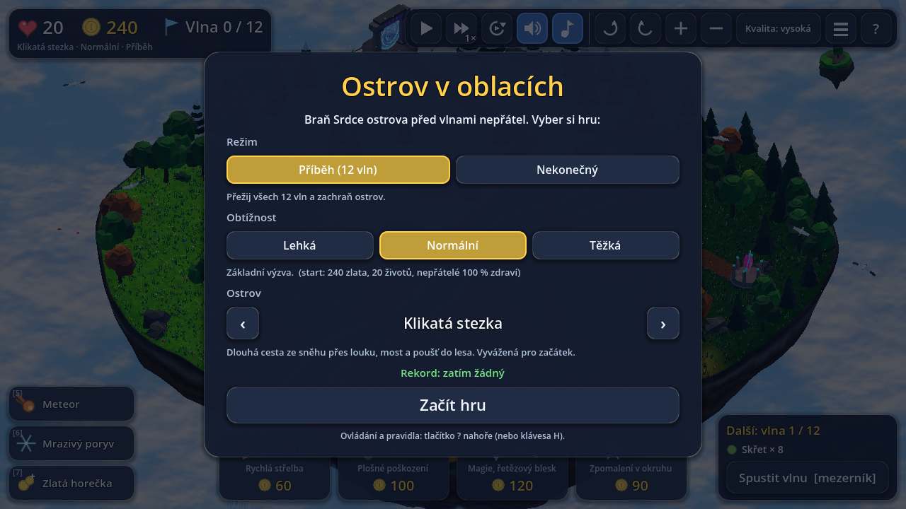 **Menu: režim, obtížnost, ostrov, rekord** | 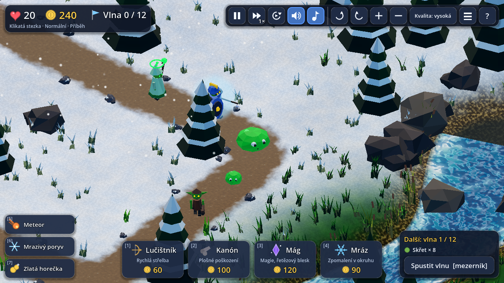 **Léčitel, štítonoš, slizák a slizánek** |
| 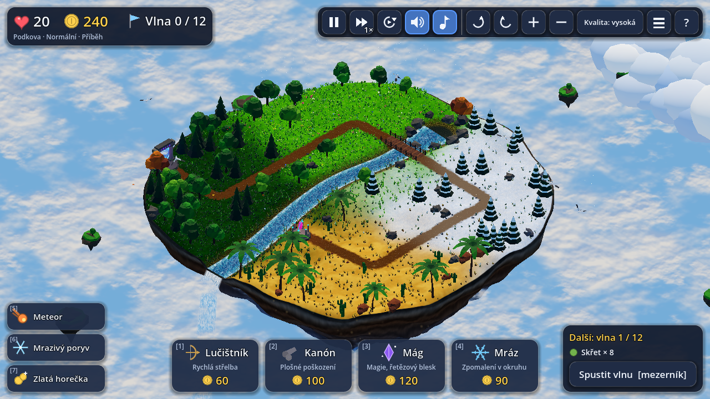 **Ostrov Podkova** | 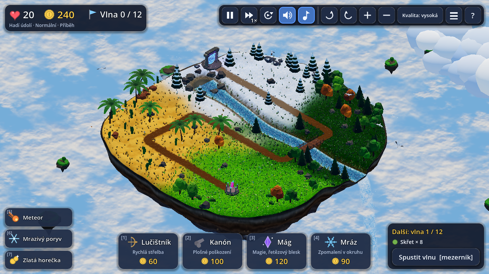 **Ostrov Hadí údolí** |
| 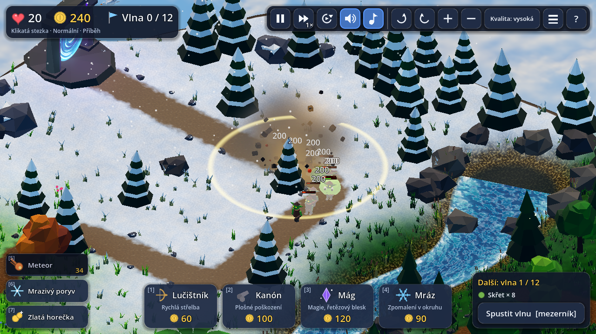 **Meteor: dopad, výbuch, poškození v okruhu** | 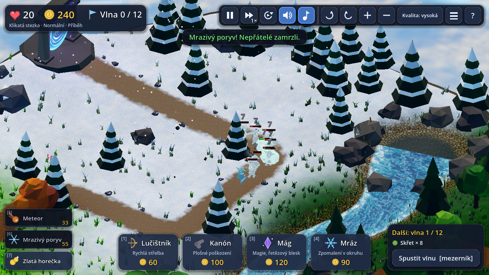 **Mrazivý poryv zmrazí všechny nepřátele** |
| 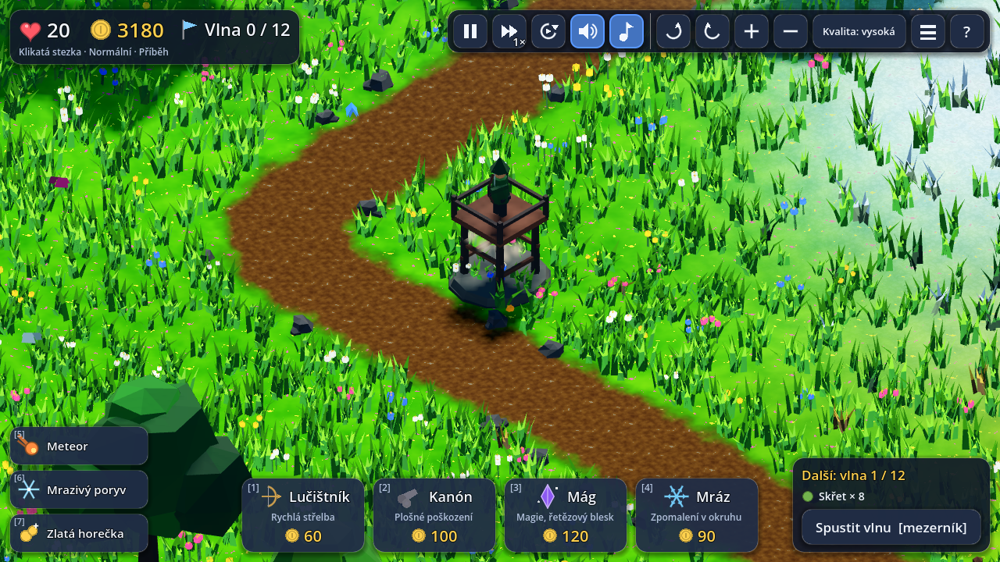 **Stavba: věž vyrůstá ze země, prach a měkký stín** | 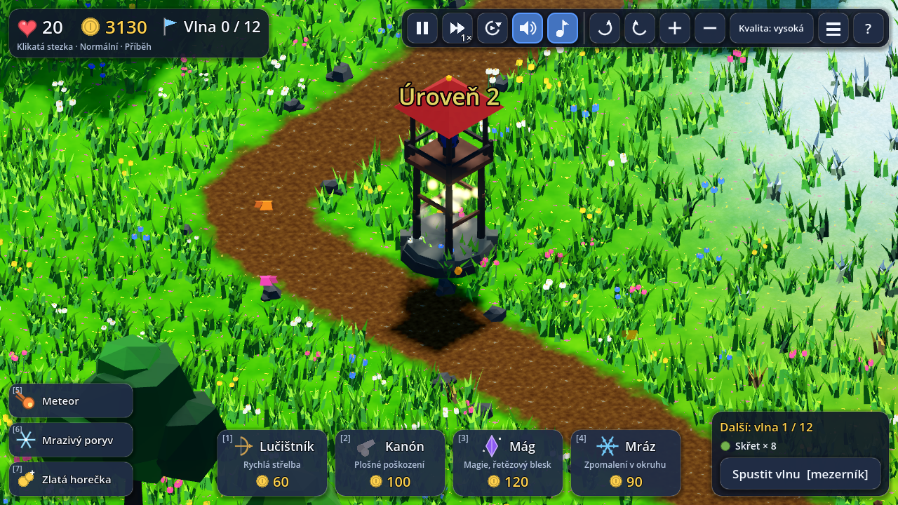 **Vylepšení: nový model se „nafoukne“, starý mizí** |
| 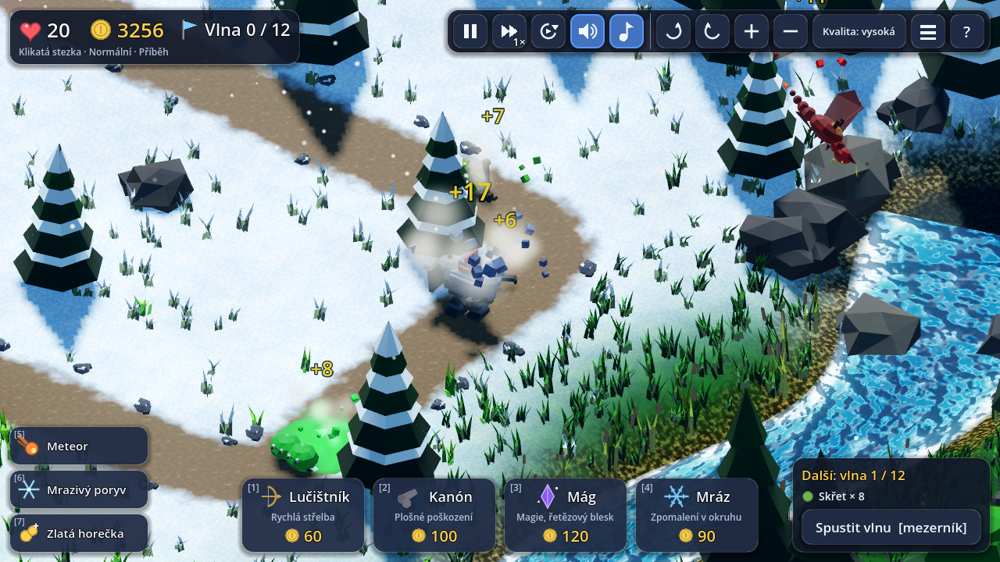 **Smrt podle typu: golem se rozpadá, dráček se řítí, slizák se rozplácne** | 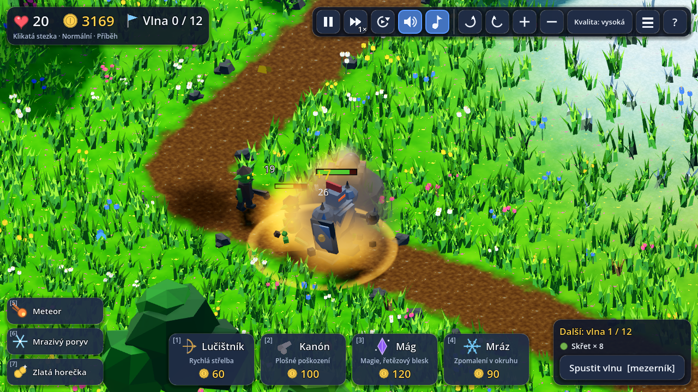 **Výstřel z děla, výbuch a spálená skvrna na zemi** |
| 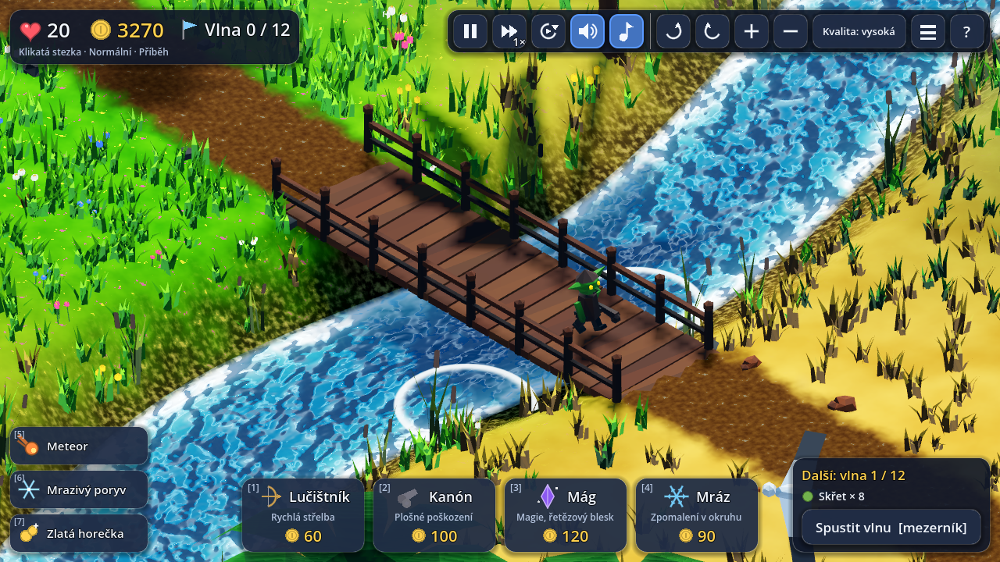 **Kruhy na hladině u mostu, pohyblivá pěna u břehu** | 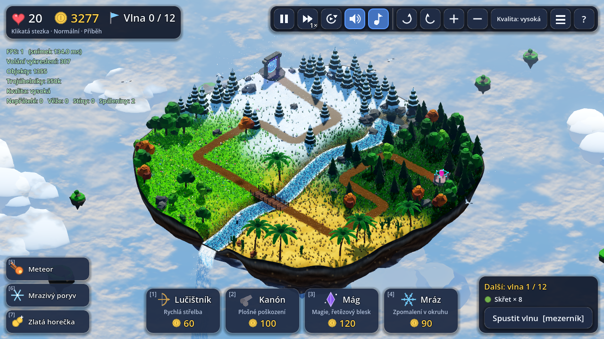 **Přehled výkonu na klávese F3 (vlevo nahoře)** |
| 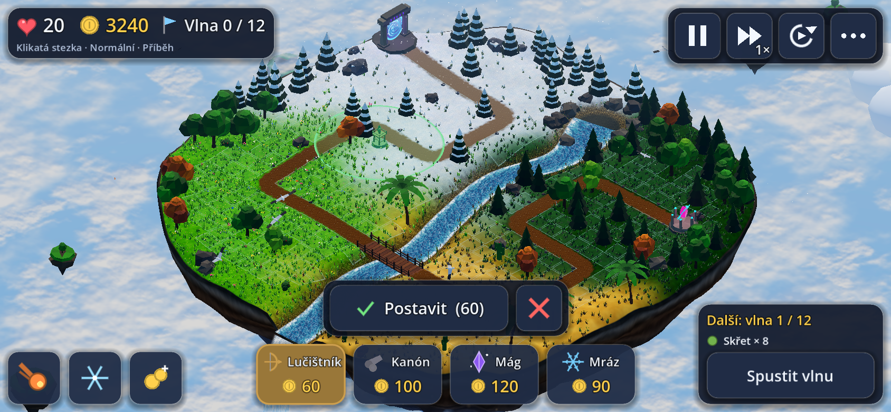 **Telefon na šířku: označené pole a potvrzení stavby** | 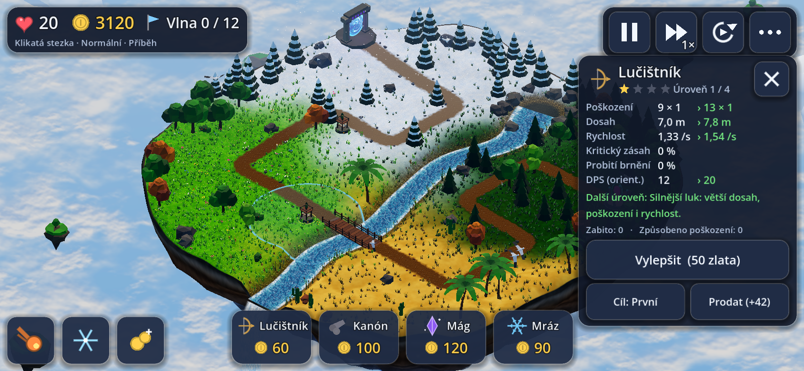 **Telefon: panel věže se zavíracím křížkem** |
| 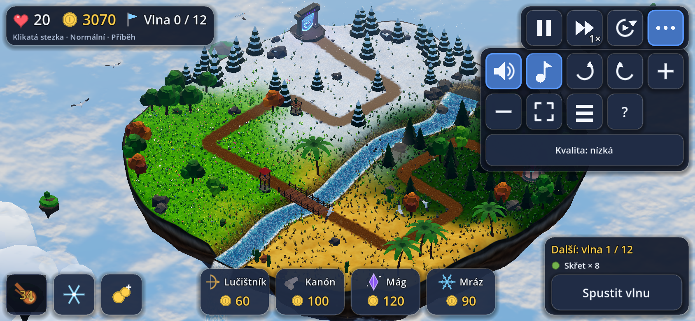 **Telefon: pod tlačítkem „…“ je zvuk, kamera, kvalita, celá obrazovka** | 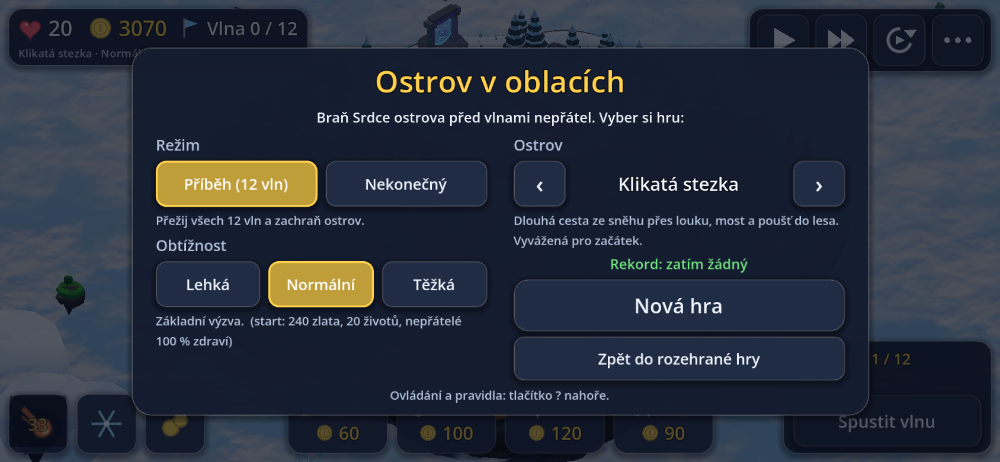 **Telefon: úvodní nabídka ve dvou sloupcích** |

## Jak hru spustit

Hra je už sestavená ve složce `docs/`. Prohlížeč ji ale nespustí dvojklikem na `index.html` (zakazuje to načítání souborů z disku), potřebuje malý místní webový server. Ten spustí jedním kliknutím:

| Systém | Co udělat |
|---|---|
| **Windows** | dvojklik na `spustit.bat` (jednorázově nainstaluj zdarma [Python](https://www.python.org/downloads/) a při instalaci zaškrtni *Add python.exe to PATH*) |
| **macOS** | dvojklik na `spustit.command` (Python 3 bývá k dispozici; jinak ho nainstaluj z python.org) |
| **Linux** | `./spustit.sh` |

Otevře se prohlížeč s hrou (adresa `http://localhost:8765/index.html`). Ukončíš ji zavřením okna terminálu.

**Záložní verze pro starší Godot.** Kdyby hra v tvém prohlížeči nešla nebo sekala, zkus build z předchozího Godotu **4.6.3** (stejná hra, stejný kód): dvojklik na `spustit_godot-4.6.bat` (Windows) / `spustit_godot-4.6.command` (macOS) / `./spustit_godot-4.6.sh` (Linux), případně `python3 spustit.py docs-4.6`. Ověřeno: pod 4.6.3 projekt projde importem i exportem a na tomto buildu prošly i kontrola mechanik (21 kontrol), test menu a nových funkcí v prohlížeči (44) a zvukový test (35), vše bez chyb v konzoli. Po grafických úpravách jsem na 4.6.3 znovu pustil kontrolu mechanik (21 / 21) a test grafiky a animací v prohlížeči (41 / 41, 0 chyb v konzoli); ostatní testy z této řady jsem po těch úpravách pustil jen na 4.7.2.
Funguje v aktuálním Chrome / Edge / Firefox. První načtení stahuje ~40 MB (engine), pak už je to rychlé.

## Ovládání

| Akce | Ovládání |
|---|---|
| Postavit věž | karta dole (nebo klávesy **1–4**) → klik na zelené pole vedle cesty |
| Zrušit stavbu / výběr | **Esc**, pravé tlačítko myši (bez tažení) |
| Vybrat věž | klik na ni → panel vlevo (statistiky, náhled vylepšení, prodej, cílení) |
| Vylepšit / prodat / cíl | tlačítka v panelu nebo **U** / **X** / **T** |
| Spustit vlnu | tlačítko vpravo dole nebo **mezerník** (tlačítko „auto“ nahoře spouští vlny samo) |
| Aktivní schopnosti | panel vlevo dole, nebo klávesy **5** (Meteor – pak klikni na mapu, **Esc** zruší), **6** (Mrazivý poryv), **7** (Zlatá horečka) |
| Nová hra, změna režimu / obtížnosti / mapy | tlačítko **☰** nahoře (nebo „Změnit nastavení“ na konci hry); volby se pamatují |
| **Minimapa** | vlevo pod panelem životů a zlata: **klik nebo tažení** přesune kameru, knoflík v rohu ji sbalí, klávesa **N** ji skryje a ukáže. Otáčí se spolu s kamerou, vidíš na ní cesty, řeku, kopce, portály, věže, nepřátele a výřez kamery |
| Otáčení kamery | **pravé tlačítko myši + tažení**, **Q / E**, tlačítka nahoře |
| Zoom | **kolečko myši**, **+ / −**, tlačítka nahoře |
| Posun kamery | **W A S D** / šipky, nebo prostřední tlačítko myši + tažení |
| Rychlost 1× / 2× / 3× | tlačítko nahoře nebo **F** |
| Pauza | **P** (nebo Esc, když není nic vybráno) |
| Nápověda (pravidla a ovládání) | **?** nahoře (nebo **H**) |
| Zvuk a hudba | tlačítka **reproduktor** (efekty a ambient) a **nota** (hudba) nahoře; klávesa **M** vypne/zapne vše. Volba se pamatuje |
| Kvalita | tlačítko *Kvalita* (vypne stíny od slunce, vyhlazování, spáleniny a jiskry; na mobilech/slabých strojích se zapne samo) |
| Přehled výkonu | **F3** – snímky za vteřinu, volání vykreslení, objekty, trojúhelníky a počty nepřátel / věží / stínů |
| **Dotyk (telefon, tablet)** | karta věže → klepnutí na pole (pole se označí, náhled věže a dosahu) → tlačítko **Postavit** nebo druhé klepnutí na totéž pole; křížek stavbu zruší. Klepnutí na věž otevře panel (vylepšit, prodat, cíl, křížek zavře). **Meteor**: klepnout na schopnost, na místo dopadu a potvrdit |
| Kamera dotykem | **jeden prst** = posun, **dva prsty** = přiblížení, otáčení (mapa se otáčí s prsty) a posun; tlačítka kamery, zvuku, kvality, celé obrazovky a nové hry jsou pod tlačítkem **…** nahoře |

## Prostředí

V menu (při startu i později přes tlačítko ☰) je volba **Prostředí**. Změna znovu postaví svět (pár sekund) a volba se pamatuje v prohlížeči; jde ji vynutit i adresou `?theme=scifi` nebo `?theme=sky_island`. Věže mají v obou prostředích stejná čísla (cena, dosah, poškození, vylepšení), nepřátelé stejné vlastnosti a vlny jsou stejné – mění se vzhled, jména, texty, efekty a zvuk.

| | **Ostrov v oblacích** | **Vesmírná stanice** |
|---|---|---|
| Svět | plovoucí ostrov nad mraky, biomy les / louka / poušť / sníh, řeka a vodopád | plošina na asteroidu v hlubokém vesmíru s mlhovinou a hvězdami, neonové biomy, dlažba s tenkými světelnými okraji, energetická řeka a vodopád, plující trosky a satelity, hlídkové drony a svítící můry |
| Začátek / cíl | portál / Srdce ostrova | hvězdná brána / reaktor stanice |
| Věže | Lučištník, Kanón, Mág, Mráz | Laser, Plazmomet, Teslova věž, Kryo věž |
| Nepřátelé | skřet, vlk, obrněnec, dráček, léčitel, štítonoš, slizák, kamenný obr | pěšák-bot, robopes, těžký mech, dron, opravář, štítový droid, nanorój, titán |
| Schopnosti | Meteor, Mrazivý poryv, Zlatá horečka | Orbitální úder, Kryo vlna, Kreditový šok |
| Měna | zlato | kredity |
| Zvuk | d moll: klidná a bojová smyčka (pad, brnkání, zvonky, žestě), vítr, voda, ptáci | a moll: synthové smyčky (pad, basa, arpeggio, lead, clap), laserové a plazmové efekty, hukot stanice, tok energie, drony |


## Pravidla

Z **portálů** (bran) na okrajích ostrova vycházejí vlny nepřátel a jdou po cestách (přes sníh, louku, mosty přes řeku, poušť a les) k **Srdci ostrova**. Mapy mají **víc bran** (každá brána má vlastní portál), **rozcestí** (cesta se rozdělí na dvě větve) a **spojení** (cesty se slijí do jedné); nepřátelé se na trasy dělí střídavě podle vah, takže ani jedna nezůstane bez nepřátel. Létající jdou přímo z portálu své trasy k Srdci. Když nepřítel dojde na konec, ztratíš životy (boss 5). Za každého zabitého dostaneš zlato, za zvládnutou vlnu bonus. V příběhu je vln **12**, v nekonečném režimu bez konce. Nepřátele věže cílí podle toho, kolik metrů jim zbývá k Srdci (ne podle podílu trasy), takže se „první“ vybere správně i při různě dlouhých trasách.

### Režimy, obtížnosti a mapy

Na začátku (a později přes tlačítko ☰) si vybereš:

| Režim | Co to je |
|---|---|
| **Příběh** | přežij všech 12 vln |
| **Nekonečný** | vlny nikdy nekončí: zdraví nepřátel roste o ~11,5 % za vlnu, počty o 7 %, každá čtvrtá vlna má bosse. Hraješ, dokud Srdce nepadne. Ukládá se **rekord** (nejlepší zvládnutá vlna) zvlášť pro každou kombinaci režimu, obtížnosti a ostrova |

| Obtížnost | Zlato | Životy | Zdraví nepřátel | Bonus za vlnu | Rychlost nepřátel |
|---|---|---|---|---|---|
| **Lehká** | 320 | 30 | 80 % | 120 % | 100 % |
| **Normální** | 240 | 20 | 100 % | 100 % | 100 % |
| **Těžká** | 220 | 15 | 125 % | 95 % | 105 % |

| Mapa | Brány a cesty | Poznámka |
|---|---|---|
| **Dvě brány** | 2 brány (západ a sever), 2 cesty po ~117 m, které se uprostřed spojí; 2 mosty | kopec s vrcholem mezi oběma cestami, další kopce u konce cesty; základní mapa k seznámení |
| **Rozcestí** | 1 brána, cesta se hned rozdělí na 2 větve (131 m), ty obkrouží skalní vrch a spojí se; společný konec 3× překročí řeku (3 mosty) | věže na vrchu uprostřed okruhu dosáhnou na obě větve |
| **Tři brány** | 3 brány a 5 tras (89–96 m): dvě brány se spojí, společná cesta se rozdělí a znovu spojí, třetí cesta se připojí těsně před Srdcem; 3 mosty | nejtěžší: nepřátelé mají o 10 % víc zdraví, ale kopce uprostřed pokryjí většinu cest |
| **Náhodný ostrov** | podle losu | náhodně jedna z map, náhodně převrácená nebo otočená (8 variant), náhodně otočené biomy a nový seed (číslo ostrova se ukáže v záhlaví) |

Všechny mapy mají **o 78 % větší plochu** než dřívější (mřížka 32 × 32 polí místo 24 × 24, ostrov ~77 m místo ~58 m) a nahrazují původní tři (Klikatou stezku, Podkovu a Hadí údolí).

Volby a rekordy se ukládají v prohlížeči (úložiště webu). Změna mapy znovu postaví svět (pár sekund), změna režimu nebo obtížnosti jen začne novou hru na stejné mapě.

### Kopce

Na každé mapě je pět kopců. Při stavbě (mřížka polí) mají jejich pole **zlatý nádech**: jeden kroužek = **kopec**, dva kroužky = **vrchol**. Věž postavená na kopci má o **15 %** větší dosah, na vrcholu o **30 %** (platí pro všechny věže a úrovně; v panelu věže stojí např. „Dosah 9,1 m (vrchol +30 %)“ a kruh dosahu při stavbě už bonus zahrnuje). Pole na kopcích se staví stejně jako ostatní, jen jich je málo (asi 33 na kopcích a 5 na vrcholech na mapu), takže je dobré si je rozmyslet. Cesty ani řeku kopec nikdy neřeže: u nich plynule slábne. Okraje kopců zdobí skalní výchozy.

### Aktivní schopnosti (panel vlevo dole)

| Schopnost | Nabíjení | Co dělá |
|---|---|---|
| **Meteor** [5] | 35 s | klikni na mapu: za chvíli (je vidět varovný kruh) dopadne a zasáhne všechny nepřátele v okruhu 3,6 m (i létající), způsobí jim velké magické poškození (ignoruje brnění; **roste s vlnou**) a zapálí je |
| **Mrazivý poryv** [6] | 55 s | zmrazí všechny nepřátele na mapě na 2,6 s a potom je na 4 s zpomalí o 50 % (boss odolává) |
| **Zlatá horečka** [7] | 80 s | na 15 s dostaneš za každého zabitého dvojnásobek zlata |

### Věže (každá má 4 úrovně, vzhled se s úrovní mění; počet zlatých drahokamů na podstavci = úroveň)

| Věž | Cena | Mechanika | Co přinášejí vylepšení |
|---|---|---|---|
| **Lučištník** | 60 | rychlé šípy, střílí i po vzduchu, slabý proti brnění | L2 víc dosahu/poškození/rychlosti · L3 **dva šípy naráz** (na různé cíle) · L4 **25 % kritický zásah ×2** a probití 50 % brnění |
| **Kanón** | 100 | pomalá koule po balistické křivce s **výbuchem**, jen pozemní cíle | L2 větší výbuch · L3 **zápalné koule** (hoření) · L4 obří výbuch + **omráčení** |
| **Mág** | 120 | naváděná magická koule, **ignoruje brnění** | L2 síla · L3 **řetězový blesk** na další 2 cíle · L4 blesk na 4 cíle |
| **Mráz** | 90 | kruhový pulz, **zpomalí všechny** v okruhu (i vzdušné) | L2–L3 větší okruh a zpomalení (až 55 %) · L4 zpomalení 65 % a **každý 3. pulz zmrazí** |

Vylepšení stojí 50–240 zlata, prodej vrací 70 % vložených peněz. Věž má režim cílení *První / Poslední / Nejsilnější / Nejbližší*.

### Nepřátelé

| Nepřítel | Vlastnost |
|---|---|
| **Skřet** | základní |
| **Vlk** (rychlý) | 1,9× rychlejší, málo zdraví |
| **Obrněnec** | pomalý, hodně zdraví, **brnění** (snižuje poškození šípů a děl; magie ho ignoruje) |
| **Dráček** (létající) | letí přímo od portálu k Srdci nad stromy, kanón ho nezasáhne |
| **Kamenný obr** (boss) | obří, hodně zdraví a brnění, odolný proti zpomalení; vlny 5, 10 a 12 |
| **Léčitel** (od vlny 7) | každé 2 s vyléčí 7 % zdraví všem okolním nepřátelům (dosah 4,6 m, kruh se ukáže). Zabij ho první |
| **Štítonoš** (od vlny 6) | před zdravím má **štít**, který pohlcuje všechno poškození; po 3 s bez zásahu se nepřetržitě obnovuje, dokud nepraskne. Slabé pomalé zásahy ho nezlomí, silné rány (kanón, mág) ano |
| **Slizák** (od vlny 4) | po smrti se rozpadne na dva rychlé **slizánky** (30 % jeho zdraví). Vlna se nedokončí, dokud žijí. Plošné poškození je výhodné |

Zdraví nepřátel s vlnami roste (vlna 12 má ×5,4). Přehled další vlny je vpravo dole, **létající** nepřátele ohlásí oranžové varování a při prvním výskytu nového typu hra vypíše jeho vlastnost.

## Svět a technika

- **Síť cest:** mapa se skládá z úseků cest; každá **trasa** je řetěz úseků od portálu k Srdci. Rozcestí vzniká, když dvě trasy sdílejí začátek, spojení, když sdílejí konec. Každá trasa má vlastní vyhlazenou křivku, vlastní seznam mostů a výšky, které se na společných úsecích shodují; nepřátelé chodí po své trase podle uražené vzdálenosti. Pole kolem cest i vzdálenost k cestě se počítají ze všech tras najednou.
- **Kopce** jsou součást výškového pole terénu (plošina se zvlněným okrajem, vrchol se přičítá ke kopci). Přičítají se až po vyrovnání cest a koryta řeky a u nich plynule slábnou, takže silnice nikdy neřeže strmý zářez. Výškový stupeň pole (0 / 1 / 2) se spočítá z plošiny a používá ho dosah věže, mřížka i minimapa.
- **Minimapa** je kruh, který se otáčí s kamerou (nahoře je směr pohledu): obrázek terénu se vyrobí jednou z dat mapy, věže, nepřátelé, portály a výřez kamery se kreslí znovu ~12× za vteřinu.
- **Létající ostrov** s biomy (sníh, les, poušť, louka – plynule přecházejí), řekou, která vyvěrá z jezírka, protéká pod dřevěným mostem a na okraji ostrova **padá jako vodopád** do oblaků. Spodek ostrova je skalní krápník.
- **Živý svět:** pohyblivé mraky v několika vrstvách, vítr hýbe stromy a trávou (ve vertex shaderu), tekoucí a pěnící voda, padající sníh, pylové jiskřičky v lese, prach v poušti, ptáci, motýli, plovoucí skály, mlha a sprška vodopádu, stíny od slunce.
- **Izometrická kamera:** ortogonální projekce, přesný izometrický sklon 35,264°, otáčení, zoom i posun.
- **Fyzika projektilů:** v každém kroku se projektilu přepočítá rychlost tak, aby letěl po balistické křivce přesně do *předpovězeného* místa cíle v čase dopadu. Cíl jde po známé trase, takže projektil vždy dorazí a zasáhne (i když se cíl zpomalí – křivka se plynule opraví). Dělová koule dopadá s výbuchem, magická koule se vlní a přeskakuje blesky.
- **Pohyb nepřátel** je dán uraženou vzdáleností po vyhlazené trase (zatáčky jsou zaoblené), takže se nemohou zaseknout ani projít skrz překážky; stromy a skály jsou jen mimo trasu a v zablokovaných polích.

### Grafika a animace (vše v kódu, běží na WebGL 2 / režimu Kompatibilita)

- **Stavba věže:** věž vyroste ze země s přeskokem (krátce přeroste 100 % a vrátí se) a kolem základny se zvedne prstenec prachu. **Vylepšení:** starý model se zmenší a zmizí, nový se „nafoukne“ z menšího na plnou velikost. **Prodej:** věž se zmenší a zvedne.
- **Střelba:** u hlavně zableskne podle typu věže (lučištník drobný, kanón velký s jiskrami, mág fialový). Šípy a koule za sebou táhnou světelnou stopu, dělová koule kouřovou. Po výbuchu zůstane na zemi **spálená skvrna** (kopíruje terén, po ~12 s sama mizí, najednou jich je nejvýš 14); po meteoru velká.
- **Příchod nepřátel:** vystoupí zpoza portálu a „nafouknou se“ (slizánci po rozpadu vyskočí na místě).
- **Smrt podle typu:** skřet a léčitel padají na záda, vlk na bok, golem a boss se rozsypou (třesou se, rozpláclé, prach), dráček se zřítí a při dopadu se rozprskne, slizák se rozplácne. Kdo dorazí k Srdci, nezmizí, ale **proletí do krystalu**, točí se a zmenšuje.
- **Hloubka (levné náhrady, protože režim Kompatibilita nemá SSAO ani volumetrickou mlhu):** jemný modrý opar do dálky, měkké kontaktní stíny pod všemi věžemi a nepřáteli (létající mají stín na zemi, který je tím menší a bledší, čím výš letí) – celé je to jediné volání vykreslení – a ztmavení spodku modelů (obarvení vrcholů).
- **Řeka:** pohyblivá pěna u břehu, kruhy na hladině po obou stranách mostu, když po něm někdo jde, a hustší mlha a sprška u vodopádu.
- Všechny drahé efekty se v **nízké kvalitě** vypínají (spáleniny, jiskry u výstřelů, skutečné stíny od slunce); měkké stíny zůstávají, protože nahrazují ty skutečné.

### Ovládání na telefonu

- **Rozpoznání:** malá dotyková obrazovka (kratší strana pod 700 px) dostane profil „telefon“; adresa `?touch=1` ho vynutí i na počítači (pro zkoušení), `?touch=0` ho zakáže. Tablety a dotykové notebooky zůstávají na běžném rozložení, ale ovládají se prstem stejně (stavba s potvrzením).
- **Kompaktní rozhraní:** obsah okna se zmenší na ~990 × 460, takže všechno je větší a čitelné (tlačítka mají aspoň 44 px na obrazovce). Karty věží mají jen ikonu, název a cenu, schopnosti jsou řada ikon vlevo dole, nástroje jsou pod tlačítkem **…**, panel věže je vpravo se zavíracím křížkem (panel vlny se přitom schová), úvodní menu je ve dvou sloupcích. Bublinové nápovědy se na telefonu nepoužívají. Rozložení hlídá test (nic se nepřekrývá a vše leží v obrazovce).
- **Klepnutí a tažení:** prst, který se nepohnul, je klepnutí; tažení posouvá kameru a nic nestaví ani nevybírá. Dotyk začínající na tlačítku nebo panelu kameru neovládá.
- **Na výšku:** hra se pozastaví a ukáže „Otoč telefon na šířku“.
- **Výkon:** na telefonu se kvalita sama sníží a rozlišení plátna se omezí na dvojnásobek CSS pixelů (telefony s hustotou 3 by jinak vykreslovaly 2,25× víc bodů); `?dpr=1` ho omezí na jeden bod. Stránka nejde přibližovat štípnutím ani posouvat tažením a dlouhé podržení neotevírá nabídku.

### Zvuk a hudba

Žádné zvukové soubory – všechno se **vysyntetizuje v kódu** (`scripts/audio/synth.gd`) při startu hry:

- **42 efektů**: výstřel šípu, rána kanónu a výbuch, kouzlo mága a blesk, mrazový pulz, zásahy, smrt každého typu nepřítele (boss má vlastní), zvonění mince, stavba / vylepšení / prodej, roh na začátku vlny, ztráta života, fanfára výhry a znělka prohry, kroky obra, kliknutí v menu, léčení, prasknutí štítu, rozpad slizáku, smrt nových nepřátel, pád a dopad meteoru, mrazivý poryv, zlatá horečka a ping, že se schopnost nabila. Efekty jsou **prostorové** (stereo podle toho, kde na ostrově se stanou, a tišší, když jsou daleko), mají drobnou náhodnou změnu výšky a omezení počtu, aby se při velké bitvě nesmísily.
- **Hudba** (d moll): klidná smyčka (88 BPM, pad + brnkání + zvonky) a bojová (124 BPM, basa, bicí, žestě). Při vlně se klidná **plynule prolne** do bojové a po ní zase zpět. Pauza a konec hry hudbu ztlumí.
- **Ambient**: vítr, šumění vody a občas ptáci na různých místech ostrova.
- Prohlížeče zvuk bez kliknutí nepustí, proto se spouští až **po kliknutí na „Začít hru“**. Hudba se dopočítává na pozadí po malých dávkách (hra přitom neseká) a začne hrát zhruba 10–30 s po načtení, na pomalém stroji později; do té doby hraje ambient a efekty.

### Struktura projektu

```
project.godot, export_presets.cfg   nastavení Godotu a exportu pro web
scripts/core/       cfg.gd (všechna čísla: věže, nepřátelé, vlny, obtížnosti, schopnosti), islands.gd (mapy: úseky cest, trasy, kopce, řeka),
                    game_settings.gd (volby a rekordy), mesh_kit.gd (stavba modelů z primitiv), gfx.gd
scripts/world/      terén (výšky, kopce, vzdálenosti k cestám a řece), trasy, řeka, mřížka polí a mosty, generování sítí ostrova
scripts/game/       hra (vlny, zlato, životy, schopnosti), věž, nepřítel, projektil, meteor, efekty, kamera, překryvy
scripts/theme/      rozhraní motivu, rejstřík motivů a oba motivy (`sky_island/` Ostrov v oblacích, `scifi/` Vesmírná stanice: svět, modely věží a nepřátel, ambient)
scripts/ui/         rozhraní (česky), ikony kreslené v kódu, minimapa
scripts/audio/      syntezátor zvuků a hudby (synth.gd), správce zvuku (audio_manager.gd)
scripts/tools/      testovací nástroje (headless simulátor, API pro testy v prohlížeči, export zvuků do WAV)
shaders/            terén, voda, vodopád, listí s větrem, mraky, portál, efekty
docs/               hotová webová verze (Godot 4.7.2, sem míří export)
docs-4.6/           záložní webová verze z Godotu 4.6.3
tests/              skripty pro automatické testy (Node + Playwright)
```

### Jak přidat další téma (sci-fi, fantasy…)

Pravidla a čísla (`cfg.gd`) jsou oddělená od vzhledu. Nový motiv = nová třída, která dědí z `GameTheme` (`scripts/theme/game_theme.gd`) a přepíše čtyři věci: `build_world` (svět), `make_tower_visual`, `make_enemy_visual`, `make_projectile_visual`. Vzor je `scripts/theme/sky_island/theme_sky_island.gd`; motiv se registruje v `scripts/theme/themes.gd`. Svět motivu si bere tvar mapy (trasy, portály, mosty, kopce) z `GameMap`, takže stačí postavit terén, stavby u portálů a mostů a dekorace; barvy minimapy jsou v `palette` pod klíči `mm_*`.

### Jak přidat další mapu

Mapy jsou v `scripts/core/islands.gd` v seznamu `LIST`. Každá je slovník:

```gdscript
{
	"name": "Dvě brány", "desc": "…", "seed": 7, "hp": 1.0,          # hp = násobek zdraví nepřátel na této mapě
	"segs": {"a": [Vector2i(0, 5), Vector2i(8, 5), …],             # úseky: lomené čáry v buňkách (mřížka 32 × 32)
	         "b": […], "tail": [Vector2i(15, 22), …]},
	"lanes": [{"segs": ["a", "tail"], "w": 1.0},                   # trasa = řetěz úseků, w = váha (kolik nepřátel půjde touto trasou)
	          {"segs": ["b", "tail"], "w": 1.0}],
	"base": Vector2i(26, 28),                                      # buňka Srdce (poslední úsek končí vedle ní)
	"river": […],                                                  # řídicí body řeky (metry); řeka vždy končí vodopádem
	"hills": [{"c": Vector2i(15, 13), "r": 6.6, "tier": 1},        # kopce: střed, poloměr paty, stupeň 1 = kopec
	          {"c": Vector2i(15, 13), "r": 4.0, "tier": 2}],       # stupeň 2 = vrchol (stojí na kopci, přičte se k němu)
	"biomes": […],                                                 # středy biomů (les, louka, poušť, sníh)
}
```

Rozcestí uděláš tak, že dvě trasy mají stejný první úsek a pak se liší; spojení tak, že mají stejný poslední úsek. Pravidla pro návrh, která hlídá `godot --headless --path . -- --simtest --islands`: trasy od sebe aspoň 6 m (mimo rozcestí a spojení), most potřebuje rovný úsek aspoň ~5 m před zatáčkou, kopec má být od cest aspoň ~6 m a mimo řeku.

### Jak hru znovu sestavit

Potřebuješ Godot **4.7.2** a k němu exportní šablony pro web. Pak:

```bash
tools/build_web.sh /cesta/k/godot      # vytvoří docs/index.html + engine + data
```

## Testy a co bylo ověřeno

Všechno níže běželo na této verzi (Godot 4.7.2.stable, Chromium s programovým vykreslováním WebGL).

| Test | Spuštění | Výsledek |
|---|---|---|
| Headless simulace (pravidla, vylepšení, fyzika, 4 strategie bota na celých 12 vlnách) | `godot --headless --path . -- --simtest --skipintro` | průběh bez chyb, viz níže |
| Headless kontrola mechanik: obtížnosti, léčitel, štítonoš, slizák, meteor, poryv, horečka, nekonečný režim, ukládání rekordů, bot v nekonečném režimu | `godot --headless --path . -- --simtest --skipintro --mech` | 23 / 23 kontrol |
| Kontrola map bez hry: délky tras, mosty (každý přes řeku, bez duplicit), volná pole a pole na kopcích, trasy uvnitř ostrova a aspoň 6 m od sebe (mimo rozcestí), výška cesty sedí na terénu (chyba ≤ 2 cm), skály nejblíž 1,76 m od cesty | `godot --headless --path . -- --simtest --islands` | všechny 3 mapy, jejich 21 převrácených / otočených variant a 6 náhodných ostrovů v pořádku |
| Menu a nové funkce v prohlížeči skutečnými kliky: výběr režimu / obtížnosti / mapy, start, uložení voleb po obnovení stránky, schopnosti (tlačítka i klávesy, míření meteoru), varování před letci, noví nepřátelé, nekonečný režim, rekordy, konec hry, náhodný ostrov | `node tests/features_browser.js` | 44 / 44 kontrol, 0 chyb v konzoli |
| Odehrání v prohlížeči skutečnou myší a klávesnicí: úvodní okno, stavba 2 lučištníků a kanónu, vylepšení kliknutím na tlačítko, 3 vlny | `node tests/e2e_play.js --low --waves=3` | všechny 3 vlny dokončeny na mapě Dvě brány (celkem 39 zabitých, ve vlně 3 proklouzli 2 dráčci – kanón po vzduchu nestřílí; věže stojí na společném konci obou tras), v obou prostředích, 0 chyb v konzoli |
| Kontrolovaný pokus „jedna věž, stejní nepřátelé, mezi koly vylepšení kliknutím“ pro všechny 4 typy | `node tests/ab_upgrade.js --type=archer` (cannon, mage, frost) | síla roste s každou úrovní, tabulka níže |
| Ovládání a obrazovky (kamera, nepovolená stavba, prodej, cílení, pauza, rychlost, prohra + restart, výhra) | `node tests/ui_flow.js` | 17 / 17 kontrol, 0 chyb v konzoli |
| Celá hra botem uvnitř exportované webové verze | `node tests/browser_bot.js` | 12 vln odehráno (na normální obtížnosti bot prohrál, jak předpovídá tabulka vyvážení), fyzika v pořádku, 0 chyb v konzoli |
| Grafika a animace: stavba / vylepšení / prodej věže (hodnoty v přesných okamžicích), příchod, smrt podle typu a vsáknutí do Srdce, spáleniny, záblesky, měkké stíny, kruhy u mostu, mlha, přehled F3, vypínání efektů v nízké kvalitě (+ snímky uprostřed pohybu) | `node tests/gfx_browser.js` | 41 / 41 kontrol, 0 chyb v konzoli |
| Dotykové ovládání v emulaci telefonu na šířku (844 × 390, skutečné dotykové události): rozpoznání telefonu, kompaktní rozložení bez překryvů a s dostatečně velkými tlačítky, stavba s potvrzením, výběr věže a panel, vylepšení, tažení × klepnutí, přiblížení a otáčení dvěma prsty (směr otáčení), meteor s potvrzením, nabídky, telefon na výšku, počítač beze změny, omezení rozlišení | `node tests/touch_browser.js` | 38 / 38 kontrol, 0 chyb v konzoli |
| Snímky světa / věží / nepřátel / boje / nových věcí | `tests/tour.js`, `gallery.js`, `combat.js`, `shots_new.js`, `shots_theme.js`, `shots_maps.js` | kontrola vzhledu |
| Zvuk v prohlížeči (měří se skutečný výstup Web Audio, viz níže) | `node tests/audio_browser.js --low` | 35 / 35 kontrol v obou prostředích, 0 chyb v konzoli |
| Prostředí (motivy): výběr v menu, přepnutí se znovunačtením světa, názvy a texty, zapamatování volby, stejná pravidla (síla věže po vylepšeních), parametr `?theme=` | `node tests/themes_browser.js` | 21 / 21 kontrol, 0 chyb v konzoli |
| **Mapy:** počty tras / portálů / mostů, délky tras, kopce, každý nepřítel začíná u portálu své trasy a dojde po ní k Srdci (i po společném úseku), střídání tras podle vah (např. 5 / 5 / 5 / 5 / 10 z 30), dosah věže 7,0 / 8,05 / 9,1 m na rovině / kopci / vrcholu a údaj v panelu věže, minimapa (nepřekrývá nic, klik přesune kameru přesně, na telefonu se sbalí a rozbalí), údaj o branách v panelu vlny, mřížka s kopci | `node tests/maps_browser.js` (a `--theme=scifi --maps=2`) | 52 / 52 kontrol na ostrově v oblacích, 20 / 20 v prostředí sci-fi, 0 chyb v konzoli |
| Rozbor všech zvuků (délka, hlasitost, přebuzení, tónina, tempo hudby) | `godot --headless -s scripts/tools/audio_dump.gd -- složka` a pak `python3 tests/audio_analyze.py složka` | všech 42 efektů + ambient + obě písně bez nalezených problémů |

**Zvuk – co přesně se měřilo** (poslech to nenahradí, viz „Co ověřeno nebylo“). Test `audio_browser.js` zachytí skutečný výstup Web Audio v prohlížeči a ověří:

- před prvním kliknutím je výstup tichý, po „Začít hru“ hraje klidná hudba, vítr a voda (RMS ≈ −22 dBFS), `AudioContext` běží,
- tlačítko noty hudbu vypne (hlasitost výstupu klesne ze 0,067 na 0,026, zůstane jen ambient), tlačítko reproduktoru vypne zbytek (0,00003), klávesa **M** vypíná a zapíná vše,
- stavba, vylepšení, výstřely, zásahy, zabití, mince, roh vlny, ztráta života, prohra a výhra přehrají svůj efekt (počítá se, kolikrát který zazněl),
- v boji se hudba plynule prolne z klidné do bojové (−14,6 dB / −9,9 dB) a po vlně zpět,
- **prostorové efekty:** výstřel vlevo od kamery má v levém kanálu 4× víc energie než v pravém, vpravo naopak, přímo před kamerou je stejně v obou,
- **přebuzení:** skutečná největší špička ze všech vzorků za celé hraní (vlna, boj, prohra, výhra) byla 0,70 z 1,0.

Rozbor vygenerovaných souborů (`audio_analyze.py`): žádné NaN, žádné ořezané vzorky, žádná stejnosměrná složka, žádné cvaknutí na začátku/konci efektů, švy smyček bez skoku; tempo písní odhadnuté z nahrávky vyšlo **88 a 125 BPM** (návrh 88 a 124), **94 % a 87 % energie leží v tónině d moll**, bojová hudba je jasnější než klidná (těžiště 1341 vs. 683 Hz). Při tvorbě testu se takto našly a opravily dvě chyby: filtr šumu byl nad 5 kHz nestabilní (fanfára výhry byla o 10 dB tišší, než měla) a vlastní zvukové sběrnice Godotu se na webu zacyklily, takže byl výstup ticho, i když zdroje hrály.

**Změřená síla vylepšení – v prohlížeči, vylepšení skutečným klikem** (jedna věž, pokaždé stejná skupina: 10 skřetů, 3 obrněnci, 6 vlků, 3 dráčci se zvýšeným zdravím; způsobené poškození / zabití / uniklých z 22):

| Věž | Úroveň 1 | Úroveň 2 | Úroveň 3 | Úroveň 4 |
|---|---|---|---|---|
| Lučištník | 387 / 0 / 22 | 690 / 0 / 22 | 2078 / 2 / 20 | 4465 / 13 / 9 |
| Kanón | 616 / 0 / 22 | 1191 / 1 / 21 | 2468 / 3 / 19 | 4833 / 15 / 7 |
| Mág | 700 / 0 / 22 | 1185 / 1 / 21 | 3319 / 6 / 16 | 5780 / 21 / 1 |
| Mráz | 505 / 0 / 22 | 1216 / 0 / 22 | 2808 / 0 / 22 | 5880 / 22 / 0 |

**Totéž v headless simulaci** (jiný, ještě těžší scénář, 24 nepřátel):

| Věž | Úroveň 1 | Úroveň 2 | Úroveň 3 | Úroveň 4 |
|---|---|---|---|---|
| Lučištník – způsobené poškození / zabití | 426 / 0 | 763 / 1 | 2236 / 4 | 4767 / 14 |
| Kanón | 740 / 1 | 1384 / 2 | 2944 / 6 | 5670 / 19 |
| Mág | 1020 / 0 | 1630 / 2 | 3905 / 5 | 6710 / 22 |
| Mráz | 535 / 0 | 1336 / 0 | 3120 / 0 | 6810 / 24 |

**Fyzika a animace** (36 odehraných her botem se schopnostmi na nových mapách: 3 mapy, 3 obtížnosti, 4 strategie, všech 12 vln, včetně léčitelů, štítonošů a slizáků): žádný skok polohy nepřítele mezi kroky větší než jeho rychlost (vnější strana zatáčky ≤ +30 %), svislý pohyb po zemi nejvýš 2,2 cm za krok, nepřítel nikdy blíž než 1,35 m ke stromu či skále, žádný nepřítel neuvízl (nejdelší život 135 s = boss na celé trase). Výška tras se na společných úsecích shoduje s terénem (chyba nejvýš 2 cm, i na všech 21 převrácených variantách map). Projektily: asi 98 000 zásahů a 7 % „vyšumělých“ (cíl zemřel jiným projektilem dřív, než střela dorazila; s plošným poškozením a rozpadajícími se slizáky je to víc než dřív).

Bot uvnitř exportu v prohlížeči (bez schopností, strategie „vysoká“, normální obtížnost, mapa Dvě brány) dopadl jako headless simulace bez schopností: prohrál ve vlně 12, fyzika v pořádku (žádný skok polohy, svislý pohyb po zemi nejvýš 2,1 cm za krok, nejbližší překážka 1,43 m).

**Vyvážení** (headless boti: 4 strategie, nehrají dokonale; používají schopnosti jako rozumný hráč: meteor na největší hlouček, poryv na nepřátele blízko cíle, horečku při velké vlně). `V` = vyhrál (s kolika životy), `P` = prohrál (ve které vlně), pořadí strategií: široká, vysoká, mix, vzduch:

| Mapa | Lehká | Normální | Těžká |
|---|---|---|---|
| Dvě brány | V15 V29 V30 V30 | P11 V14 V4 V15 | P8 P12 P10 V5 |
| Rozcestí | V30 V30 V30 V30 | P12 V20 V20 V20 | P9 P12 P10 V5 |
| Tři brány (zdraví nepřátel +10 %) | V28 V30 V30 V30 | V2 V20 P12 V20 | P10 P12 P10 P12 |

Lehká se dá vyhrát skoro vždy, **normální** zvládne většina strategií (na hraně, hlavně poslední vlna s bossy), na **těžké** vyhrály jen 2 z 12 her (strategie „vzduch“ na mapách Dvě brány a Rozcestí s 5 životy) a ostatní došly do vlny 8–12, takže je určená zkušeným hráčům. Bez schopností je normální o hodně těžší (na každé mapě vyhrála ze 4 strategií nejvýš jedna; na Dvou branách žádná). Boti umí jen stavět a vylepšovat a stavějí hlavně podél jedné cesty, člověk umí víc, takže těžká může být pro lidi zvládnutelnější, než tabulka naznačuje. První tři vlny zvládne bez ztráty života 27 ze 36 botů; unikají hlavně dráčci (letí přímo k Srdci mimo cesty) a bossové.

### Co ověřeno nebylo

- **Plynulost (FPS) na skutečné grafické kartě.** Tady běží WebGL jen programově (~1–2 snímky/s), takže rychlost vykreslování nejde posoudit. Změřené zatížení vykreslování (to jde i programově; klávesa **F3** ho ukáže přímo ve hře): prázdný ostrov 293 volání vykreslení / ~1 100 objektů / 0,55 mil. trojúhelníků ve vysoké kvalitě a 265 / ~1 090 / 0,30 mil. v nízké; scéna s 10 věžemi a 10 nepřáteli 512 / ~1 400 / 0,57 mil. (vysoká) a 409 / ~1 300 / 0,31 mil. (nízká). Proti verzi před grafickými úpravami přibylo asi 4 % volání vykreslení (491 → 512 ve vysoké, 393 → 409 v nízké kvalitě), trojúhelníků je stejně. Kdyby hra na slabším stroji sekala, přepni tlačítkem *Kvalita* na nízkou.
- **Jak se nové animace a efekty tváří v pohybu.** Animace jsem ověřil číselně (velikost, otočení a poloha v přesných okamžicích) a na snímcích zastavených uprostřed pohybu, ale pohyb samotný jsem neviděl. Jestli je odraz při stavbě věže přiměřený, smrt nepřátel nevleklá a mlha, stíny a ztmavení modelů dost nebo příliš výrazné, musíš posoudit ty. Hodnoty jsou na jednom místě: trvání a odraz v `tower_visual.gd` (`BUILD_TIME`, `ease_out_back`), smrti v `enemy.gd` (`_animate_death`) a `enemy_models.gd`, mlha ve `world_builder.gd` (`fog_*`), síla stínů v `blob_shadows.gd`.
- **Skutečný telefon.** Dotykové ovládání jsem zkoušel jen v emulaci Chromia (dotykové události a velikost telefonu na šířku 844 × 390, hustota pixelů 2 a 3). Na skutečném zařízení neznám rychlost vykreslování ani to, jak se tahy prstem opravdu „cítí“ (citlivost posunu, otáčení a přiblížení je v `camera_rig.gd`, práh klepnutí `TAP_MOVE_MAX`). Safari na iPhonu jsem nezkoušel vůbec (na iPhonu Safari celou obrazovku pravděpodobně nepodporuje, tlačítko tam asi nic neudělá), stejně jako různé tvary displejů a výřezy.
- Safari (Mac i iPhone) a Firefox na telefonu. Zkoušel jsem jen Chromium.
- **Jak se nové věci hrají člověku.** Vyvážení jsem měřil jen boty. Nevím, jestli je těžká obtížnost zábavně těžká, nebo zbytečně krutá, ani jak se ti budou líbit nové schopnosti a nepřátelé. Čísla jsou na jednom místě (`scripts/core/cfg.gd`: `DIFFICULTIES`, `ABILITIES`, `ENEMIES`, `WAVES`), takže jdou snadno ladit.
- **Náhodné ostrovy.** Ověřil jsem rozložení cesty a krajiny pro 6 náhodných čísel, ale hru botem jsem na nich nehrál. Cesta je vždy jedno ze tří existujících rozložení (vybrané náhodně), náhodné je jen otočení biomů a rozmístění stromů a skal.
- **Dvě cesty, které se sbíhají.** To jsem nedělal (hra má jeden portál a jednu trasu).
- **Jak zvuk skutečně zní.** Poslouchat neumím, takže kvalitu (jestli je hudba příjemná, jestli jsou efekty vyvážené a nepřehlušují se) musíš posoudit ty. Ověřil jsem jen to, co se dá změřit: že zvuk hraje, kdy má, že tlačítka ho vypnou, že se hudba přepíná podle boje a že výstup nepřebuzuje. Kdyby ti nějaký zvuk nevyhovoval, jsou v `scripts/audio/synth.gd` (receptury) a `audio_manager.gd` (hlasitosti `BASE_DB`, `CALM_DB`…) snadno upravitelné.
- **Smyčky ve webové verzi.** Godot je na webu přehrává tak, že po dohrání zdroj spustí znovu. Na přechodu proto může být krátká mezera, jejíž délka závisí na plynulosti hry (zhruba jeden snímek). V testu na pomalém stroji s ~1–2 snímky/s byla mezera stovky milisekund, na normálním počítači by měla být řádově desítky milisekund. Aby se to dělo zřídka, jsou hudební smyčky dlouhé 31 s a 44 s a ambient 24 s. Na skutečném stroji jsem to neměřil.
- Binárku Godotu 4.7.2 (a web šablony) jsem získal ze zrcadla komunitního Docker image `barichello/godot-ci`, protože oficiální stránky byly v prostředí zablokované. Oficiální kontrolní součet jsem proto neověřil; program hlásí `4.7.2.stable.official`. Výsledný web (`docs/`) ti ale nic dalšího nestahuje – obsahuje jen engine a hru.
